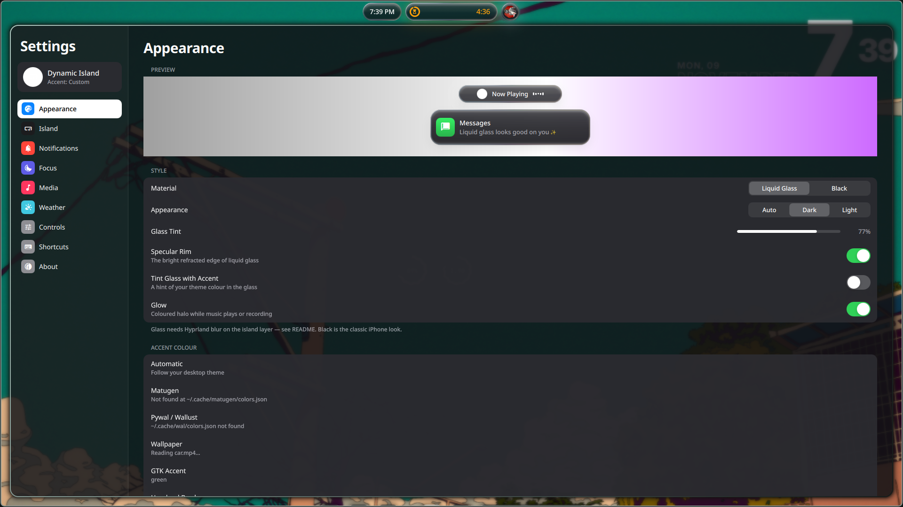

# quickshell-island

A dynamic island for Hyprland, written in Quickshell. It sits at the top of the
screen and grows when something happens: a song starts, a timer runs, a
notification arrives, you press the launcher key.

---

---

It does three jobs:

- **Island.** Music, timer and recording show up as live activities. Click it to
  open a panel with a clock, weather, calendar, media player and quick toggles
  (Wi-Fi, Bluetooth, night shift, brightness, volume and so on).
- **Notifications.** It replaces your notification daemon. Banners, a
  notification center with grouped stacks, inline reply, do not disturb.
- **App launcher.** Press a key and the island turns into a search box.

It runs as its own Quickshell instance (`qs -c island`), so it can sit next to
whatever bar you already use.

<!-- Add screenshots here: docs/island.png, docs/launcher.png, docs/notifications.png -->

## Requirements

- Hyprland. The code uses `Quickshell.Hyprland` directly, so Sway, Niri and the
  rest won't work.
- Quickshell 0.2 or newer, and Qt 6.8 or newer.

Packages on Arch:

```bash
sudo pacman -S --needed quickshell brightnessctl networkmanager bluez bluez-utils \
  grim slurp wl-clipboard libnotify curl inter-font sound-theme-freedesktop glib2 libpulse
yay -S --needed ttf-material-symbols-variable-git cava hyprpicker hyprsunset
```

If `quickshell` isn't in your repos, use `quickshell-git` from the AUR.

Optional:

- `otf-apple-sf-pro` for SF Pro. Without it the font falls back to Inter.
- `geoclue` for Wi-Fi based location. Without it the weather uses an IP lookup,
  or you can type in your city.
- `cava` drives the music visualizer. `hyprpicker` is the colour picker and
  `hyprsunset` is night shift.

Other distros: install the same things under whatever they are called there.
**Settings → About → Dependencies** lists what's missing and which feature needs it.

## Install

```bash
git clone https://github.com/<your-user>/quickshell-island ~/.config/quickshell/island
qs -c island
```

The folder name matters: `qs -c island` looks for `~/.config/quickshell/island`.

## Hyprland config

Add this to `hyprland.conf`:

```ini
exec-once = qs -c island

# blur behind the island (Hyprland 0.53+)
layerrule = blur on, match:namespace quickshell:island
layerrule = ignore_alpha 0.35, match:namespace quickshell:island
# Hyprland 0.52 and older:
# layerrule = blur, quickshell:island
# layerrule = ignorealpha 0.35, quickshell:island

# the settings window should float
windowrule = float on, match:title ^(Island Settings)$
# 0.52 and older:
# windowrule = float, title:^(Island Settings)$

bind = SUPER, space, global, quickshell:islandLauncher   # launcher
bind = SUPER, I,     global, quickshell:islandToggle     # open/close the island
bind = SUPER, N,     global, quickshell:islandCenter     # notification center
bind = SUPER, comma, global, quickshell:islandSettings   # settings

bindel = , XF86MonBrightnessUp,   exec, brightnessctl -q s 5%+ && qs -c island ipc call island brightness
bindel = , XF86MonBrightnessDown, exec, brightnessctl -q s 5%- && qs -c island ipc call island brightness
```

Pick whatever keys you like. Blur has to be enabled in your `decoration`
section (it is by default). If Hyprland complains about a rule, run
`hyprctl version` and use the syntax for your version.

## Launcher

Open it with the `islandLauncher` bind. Then:

| You type | What happens |
| --- | --- |
| a name | Fuzzy search over your installed apps. Apps you open often move up. |
| `> some command` | Runs the command. `Ctrl+Enter` runs it in a terminal. |
| `2*(3+4)` | Shows the answer. `Enter` copies it. |

`↑`/`↓` or `Tab` to move, `Enter` to open, `Esc` to close.

Usage counts are stored in `launcher-history.json` in the island folder. It's
git-ignored and safe to delete.

## Notifications

When the island starts it stops mako, dunst, swaync and fnott so it can own
`org.freedesktop.Notifications`. **Settings → Notifications** shows who owns it
right now and has a Take Over button.

To keep the old daemon from starting again:

```bash
systemctl --user disable --now mako swaync dunst
```

Also delete any `exec-once = mako` style lines from your Hyprland config.

If your bar is a Quickshell config that runs its own notification server, the
island can't stop it without killing the bar. Turn notifications off in the bar
config instead.

To go back: switch off *Allow Notifications* in settings and start the old
daemon.

Banners can appear under the island, inside it, or in the top-right corner.
Swipe one sideways to dismiss it, or up to send it to the notification center.
Hover for action buttons and inline reply.

## Colours

The accent colour is taken from the first of these that exists:

1. A Matugen JSON file with a `primary` colour (set the path in settings)
2. Pywal or Wallust, `~/.cache/wal/colors.json`
3. The GTK accent colour
4. Hyprland's active border colour

You can also use the album art or a fixed colour. Light and dark follow GTK's
`color-scheme`. The files are watched, so changing wallpaper re-tints the island
without a restart.

## Controls

Mouse on the island: left click expands it, right click opens Controls, middle
click plays or pauses, scroll changes volume.

With it open: `←`/`→` or `1`–`4` switch tabs, `Space` plays or pauses, `Esc` closes.

From the command line:

```bash
qs -c island ipc call island <command>
```

Commands: `toggle`, `open <tab>`, `close`, `settings`, `center`, `launcher`,
`dnd`, `timer <seconds>`, `playPause`, `pause`, `next`, `previous`, `brightness`,
`osd <icon> <label> <value>`.

## Settings

Open them from the island, or with the `islandSettings` bind. Everything is live
and is saved to `settings.json` in the island folder. The file is created on
first run. Delete it to reset.



## Ryoku

I use this on Ryoku Linux. For lock, suspend, logout, reboot and shutdown it
uses `ryoku-shell` if it's installed. Otherwise it runs `loginctl lock-session`,
`systemctl suspend` / `reboot` / `poweroff` and `hyprctl dispatch exit`. You don't need Ryoku for anything else.

## Troubleshooting

- **Nothing shows up.** Run `qs -c island` in a terminal and read the output.
  A missing Qt module or an old Quickshell version is the usual cause.
- **No blur.** The `layerrule` lines are missing or use the wrong syntax for
  your Hyprland version.
- **Notifications still come from the old daemon.** Use Take Over in settings,
  or disable the old daemon as shown above.
- **Icons are boxes.** Install `ttf-material-symbols-variable-git`.
- **Weather is wrong.** Settings → Weather, search for your city.

## Contributing

Issues and pull requests are welcome. The QML is split by feature. `Hub.qml`
holds shared state and the IPC handlers, `Island.qml` is the island itself,
`Notifs.qml` is the notification server, `LauncherPage.qml` is the launcher, and
`SettingsWindow.qml` is the settings UI.

## License

MIT, see [LICENSE](LICENSE).
