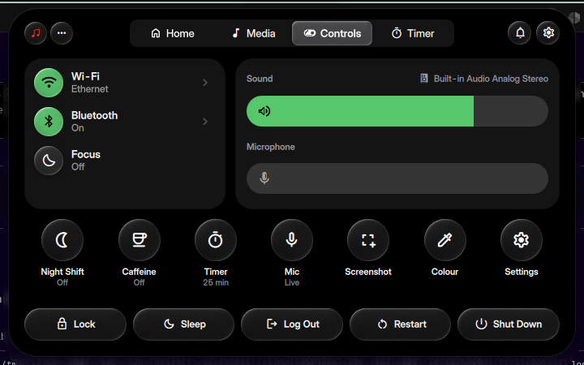
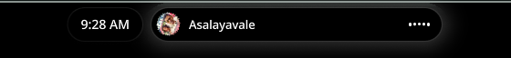
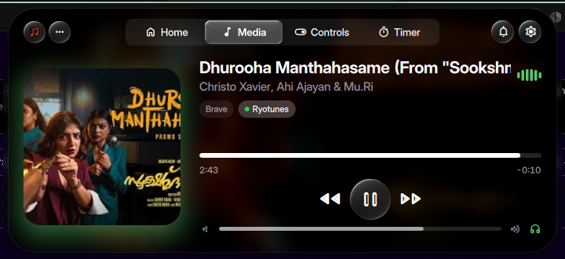
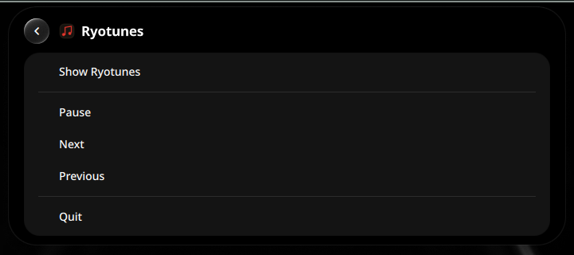
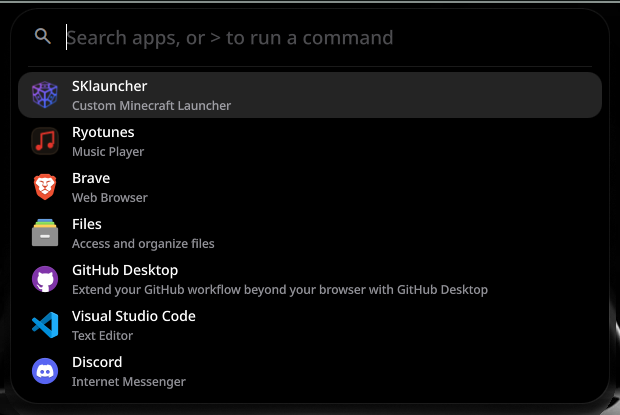
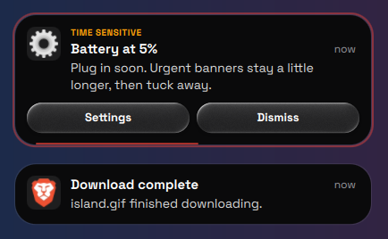
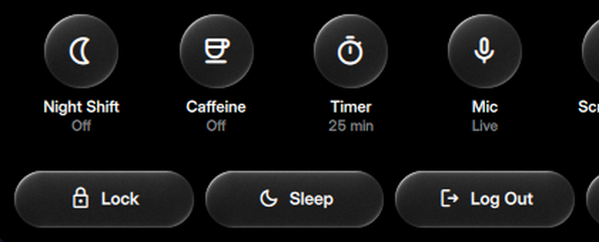
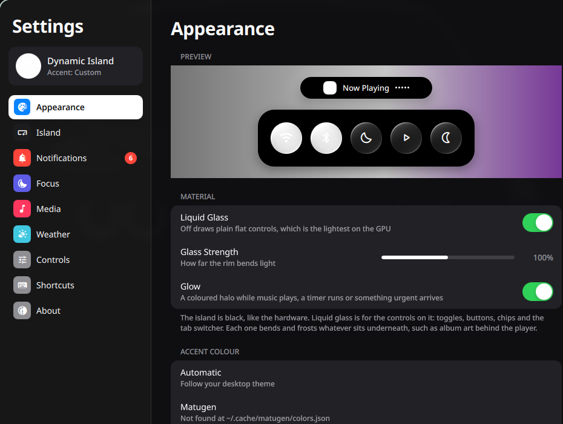

# Dynamic Island

A Dynamic Island for the Linux desktop, written in Quickshell. A black pill sits at the top of the screen and grows when something happens: a song starts, a timer runs, a notification arrives, you open the launcher. Click it and it becomes a small dashboard. The controls on it are liquid glass.

**Version 4.0.0** · [Changelog](CHANGELOG.md) · MIT



## What's in it

**Live activities.** Music, timers, the stopwatch and screen recording take over the pill while they run. A second activity splits off into its own bubble, and the clock steps out to the left so the time never disappears. Hover to peek at more.



**A dashboard.** Click the island for four tabs: Home (clock, weather, calendar, system rings, now playing), Media, Controls (Wi-Fi and Bluetooth menus, sound and brightness, Night Shift, Caffeine, power) and Timer.

**Notifications.** Banners drop out from under the island and slide back into it. Older ones tuck behind the newest and fan out on hover. The Notification Center groups by app, and supports swipe to clear, inline reply and Do Not Disturb.

**A launcher.** The pill stretches into a search field. Apps you open often rise to the top, sums are answered as you type, and anything after `>` runs as a command.

**The system tray, inside the island.** Tray apps sit next to the tabs. Their menus open in the island itself, with submenus and checkboxes, so a menu can never be left floating or collapse the island under you.

| | |
|---|---|
|  |  |
|  |  |

## Liquid glass, where it belongs

The island is black, like the hardware cut-out it imitates. Glass is for what you touch: toggles, buttons, the tab switcher, tray beads, the launcher's selection. Each control is a small lens. It bends what sits underneath it at the rim, frosts it, lifts it slightly and catches light along its top edge. Over album art you can watch the artwork warp at the edges of the play button.

It's a fragment shader, not a translucent fill. [docs/liquid-glass.md](docs/liquid-glass.md) explains how it works and what each setting changes. If your GPU would rather not, Settings → Appearance → Liquid Glass switches every control to a flat fill.



## Two ways to run it

**On Ryoku**, install it from Ryostore. The island ships there as a bar style, and three of its parts are also available on their own for any bar style. [docs/ryostore.md](docs/ryostore.md) lists what goes where.

| Ryostore catalogue | Item | What you get |
|---|---|---|
| Bar styles | Dynamic Island | The whole thing: island, dashboard, notifications, launcher, tray |
| Notifications | Island | The notification card on its own |
| App launchers | Island | The launcher on its own, on Super+Space |
| On-screen displays | Island | The volume, brightness and keyboard pill on its own |

**Anywhere else on Hyprland**, run the standalone build next to whatever bar you already use. It brings its own notification daemon.

## Standalone install

You need Hyprland, Quickshell 0.2 or newer, and Qt 6.8 or newer.

```bash
sudo pacman -S --needed quickshell networkmanager bluez bluez-utils brightnessctl \
  grim slurp wl-clipboard libnotify curl inter-font sound-theme-freedesktop glib2 libpulse
yay -S --needed ttf-material-symbols-variable-git cava hyprpicker hyprsunset
```

If `quickshell` isn't in your repositories, use `quickshell-git` from the AUR. `otf-apple-sf-pro` is picked up automatically if you have it; otherwise the island uses Inter. `geoclue` gives the weather a precise location instead of an IP guess. Settings → About lists anything missing and the feature it would turn on.

Clone the repository anywhere and link the standalone folder into Quickshell's config directory:

```bash
git clone https://github.com/Alan-Betty/quickshell-DynamicIsland ~/src/dynamic-island
ln -s ~/src/dynamic-island/standalone ~/.config/quickshell/island
qs -c island
```

Upgrading from 3.x: the repository layout changed. Remove the old clone in `~/.config/quickshell/island` and use the link above. Your `settings.json` carries over if you copy it into `standalone/`.

### Hyprland config

```ini
exec-once = qs -c island

bind = SUPER, space, global, quickshell:islandLauncher
bind = SUPER, I,     global, quickshell:islandToggle
bind = SUPER, N,     global, quickshell:islandCenter
bind = SUPER, T,     global, quickshell:islandTray
bind = SUPER, comma, global, quickshell:islandSettings

bindel = , XF86MonBrightnessUp,   exec, brightnessctl -q s 5%+ && qs -c island ipc call island brightness
bindel = , XF86MonBrightnessDown, exec, brightnessctl -q s 5%- && qs -c island ipc call island brightness

windowrule = float on, match:title ^(Island Settings)$
```

The keys are suggestions. No blur rule is needed: the island is opaque, and the glass is drawn by the island itself.

### Notifications

On start the standalone build stops mako, dunst, swaync and fnott so it can own `org.freedesktop.Notifications`. To keep them from coming back:

```bash
systemctl --user disable --now mako swaync dunst
```

Also remove any `exec-once = mako` style lines. If your bar is a Quickshell config with its own notification server, turn that off in the bar; the island can't stop it without stopping the bar. Settings → Notifications shows who owns the bus right now and has a Take Over button.

### The standalone build on Ryoku

Ryostore is the usual way to run the island on Ryoku. If you'd rather run the standalone build there, start it with systemd instead of `exec-once`. The Ryoku shell has its own notification server that can't be switched off, and whichever process claims the bus first keeps it. [`extras/ryoku/dynamic-island.service`](extras/ryoku/dynamic-island.service) starts the island before `ryoku-shell.service` and waits until the island holds the bus. The shell then starts, finds the bus taken and waits. If the island stops, the shell takes notifications back by itself.

```bash
cp extras/ryoku/dynamic-island.service ~/.config/systemd/user/
systemctl --user daemon-reload
systemctl --user enable --now dynamic-island.service
systemctl --user restart ryoku-shell.service   # once, so the shell lets go of the bus
```

Notifications then show up in the island's Notification Center, not the shell's. To give them back, `systemctl --user disable --now dynamic-island.service` and restart the shell.

## Using it

| On the island | |
|---|---|
| Click | Open the dashboard (or the activity you clicked) |
| Right-click | Controls |
| Middle-click | Play / pause |
| Scroll | Volume |
| `←` `→` or `1`–`4` | Switch tabs |
| `Esc` | Back one level, then close |

| In the launcher | |
|---|---|
| A name | Fuzzy search over your apps |
| `2*(3+4)` | The answer; Enter copies it |
| `> command` | Runs it; Ctrl+Enter runs it in a terminal |

| Notifications | |
|---|---|
| Swipe a banner up or sideways | Send it to the Notification Center |
| Pull a banner down, or ⌄ | Actions and reply |
| Swipe left in the Center | Options / Clear |

Banners stay for five seconds by default. Urgent ones stay for twelve and then tuck away. They used to wait until you dismissed them, which is now a setting (Keep Urgent Banners) and is off by default.

### From the command line

```bash
qs -c island ipc call island <command>
```

`toggle` · `open <tab>` · `close` · `settings` · `center` · `tray` · `trayMenu <app>` · `launcher` · `dnd` · `timer <seconds>` · `playPause` · `pause` · `next` · `previous` · `brightness` · `osd <icon> <label> <value>` · `clearBanners`

## Settings

Open them from the gear on the island or with `islandSettings`. Every change applies immediately and is saved to `settings.json`: in `standalone/` for the standalone build, and in `~/.config/ryoku/dynamic-island/` on Ryoku. Delete the file, or press Reset in Settings → About, to start over.

The accent colour follows your desktop. Automatic takes the first of Matugen, Pywal or Wallust, the wallpaper, the GTK accent and your Hyprland border (on Ryoku, the Ryoku palette comes first). You can also pin it to album art or a colour of your own.



## Repository layout

```
shared/      the island itself; the one place to edit QML
standalone/  the Hyprland build: shell.qml, Platform.qml, plus copies of shared/
ryostore/    the Ryostore items, each a self-contained folder
tools/       sync.sh, build-shaders.sh, stage-ryostore.sh
extras/      a systemd unit for running the standalone build on Ryoku
docs/        how the glass works, how the store items fit, how to develop
```

Everything compositor- or desktop-specific lives in one file per build, `Platform.qml`. The rest is shared, and `tools/sync.sh` copies it into each package. [docs/development.md](docs/development.md) has the details.

## Troubleshooting

**Nothing shows up.** Run `qs -c island` in a terminal and read the output. A missing Qt module or an old Quickshell is the usual cause.

**The controls look flat.** Liquid Glass may be off (Settings → Appearance), or your GPU refused the shader. The log says which.

**Notifications still come from the old daemon.** Use Take Over in Settings → Notifications, or disable the daemon as shown above. On Ryoku, Take Over can't stop the shell's server; use the systemd unit from [The standalone build on Ryoku](#the-standalone-build-on-ryoku).

**Icons are boxes.** Install `ttf-material-symbols-variable-git`.

**The weather is somewhere else.** Settings → Weather, search for your city.

## Contributing

Issues and pull requests are welcome. Edit files in `shared/` (or a `Platform.qml`), then run `tools/sync.sh`. Run `tools/sync.sh --check` before you push.

## License

MIT. See [LICENSE](LICENSE).
